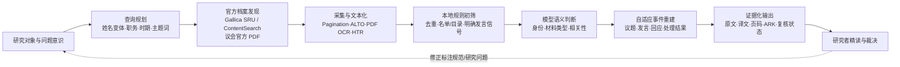
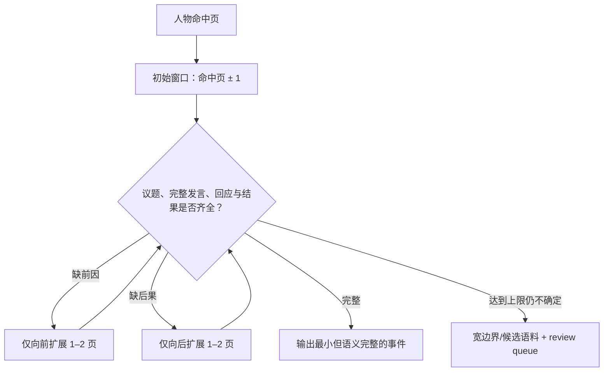

# 系统架构

本作品集展示的是一套已经服务于真实法国史研究的工作流，而不是一个把全文直接交给大模型的聊天机器人。核心目标是把“文献命中”转化为**可验证的历史事件**，并明确区分确定性程序、语义模型和研究者判断。

## 1. 从研究问题到证据链

检索、OCR和模型输出均不是最终事实。可用于研究的记录必须能够回到原始文献、扫描页和法文证据。

## 2. 三层执行架构

| 层次 | 主要职责 | 为什么这样分配 |
|---|---|---|
| Python与规则 | API、下载、缓存、去重、重试、页码映射、明确名单/目录和程序信号 | 结果确定、可测试，不应消耗模型Token |
| 大模型 | 模糊身份判断、材料分类、事件边界、回应关系、翻译 | 需要语境理解，但输出必须结构化并保留证据 |
| 研究者 | 定义标签、建立金标准、裁决疑难样本、形成历史解释 | 高风险判断和学术责任不可外包给模型 |

Codex用于原型开发、代码维护和异常诊断；稳定生产由本地Python与模型API执行。长时间下载、等待和重试不依赖Agent会话。

## 3. 事件重建与异常分流

系统不会因单条材料不确定而停止全年任务。下载失败进入持久重试队列；模型结构错误保留原始响应后重试；OCR破损、身份冲突和复杂边界进入人工复核队列。只有明确无关的材料才被排除，且排除理由仍被记录。

## 4. 可追溯数据对象

每个事件至少关联以下对象：

- 原始馆藏标识、文献ARK/PDF URL、扫描页与印刷页；
- 未改写的OCR或转录、人物命中及其上下文；
- 规则结果、模型结构化判断、Prompt/模型版本与费用；
- 事件起止、Landry发言范围、回应关系和相关性等级；
- 人工复核状态、裁决记录及最终Markdown。

缓存以文献标识和扫描页为唯一键；同一页面被多个事件引用时只下载一次。原始材料、派生文本、模型判断和研究解释分层保存，避免模型生成内容污染史料事实层。
